# Laboratorio de Canary Release

**Nginx · Docker Compose · Vagrant · GitHub Actions**

**Alumno:** Claudio Josué Trujillo Zepeda  
**Experiencia educativa:** Despliegue de software  
**Fecha de realización:** 16 de octubre de 2026

Este laboratorio demuestra una liberación gradual de una API: se conserva Blue (`v1`) como versión estable, se introduce Green (`v2`) con una fracción del tráfico y se aumenta su participación antes de promoverla por completo. También se provoca un fallo funcional para decidir y ejecutar un rollback.

El repositorio conserva el código base de [sdominguez/deployment-strategies](https://github.com/sdominguez/deployment-strategies). La práctica documentada se encuentra en [`demo_canary/canary_lab`](demo_canary/canary_lab), y la guía proporcionada está en [`docs/manual.pdf`](demo_canary/canary_lab/docs/manual.pdf).

## Contenido

- [Objetivo y fundamentos](#objetivo-y-fundamentos)
- [Arquitectura y archivos](#arquitectura-y-archivos)
- [Preparación y reproducción](#preparación-y-reproducción)
- [Etapas de despliegue](#etapas-de-despliegue)
- [Incidente y rollback](#incidente-y-rollback)
- [Resultados](#resultados)
- [GitHub Actions](#github-actions)
- [Preguntas de la actividad](#preguntas-de-la-actividad)
- [Reflexión técnica: criterios de promoción](#reflexión-técnica-criterios-de-promoción)
- [Conclusión](#conclusión)
- [Referencias](#referencias)

## Objetivo y fundamentos

El objetivo es reducir la exposición inicial de una nueva versión, observar su comportamiento y tomar una decisión sustentada en resultados antes de aumentar el tráfico. La secuencia del laboratorio es Blue 100 %, Canary 10 %, Canary 50 % y Green 100 %; ante un defecto, se vuelve a Blue.

El nombre Canary alude al uso histórico de canarios como señal temprana de peligro en las minas. En software, una exposición pequeña permite advertir una regresión antes de extenderla a todas las solicitudes.

| Estrategia | Forma de introducir la nueva versión | Implicación |
|---|---|---|
| Recreate | Se retira la versión anterior y después se inicia la nueva. | Puede existir una interrupción entre ambas versiones. |
| Blue-Green | Coexisten dos versiones y se cambia el tráfico hacia la nueva. | Facilita volver a la anterior, pero un cambio completo puede exponer de inmediato a toda la población. |
| Canary | Coexisten las versiones y se aumenta progresivamente el tráfico de la nueva. | Reduce el alcance inicial de un defecto; requiere métricas, observación y criterios de decisión. |

Canary resulta apropiado para servicios con suficiente tráfico, contratos compatibles entre versiones y una reversión rápida. Los cambios irreversibles en datos, las sesiones sin afinidad y las muestras insuficientes requieren medidas adicionales.

## Arquitectura y archivos

Las peticiones llegan a Nginx por el puerto `8080` de la VM. El proxy escucha en su puerto interno `80` y selecciona uno de los servicios de la red de Compose.

| Componente | Función | Puerto |
|---|---|---|
| `proxy` | Nginx; aplica la configuración de enrutamiento activa. | VM `8080` → contenedor `80` |
| `blue` | API Node.js estable, identificada como `v1`. | `3000`, interno |
| `green` | API Node.js nueva, identificada como `v2`. | `3000`, interno |
| Red `canary` | Comunicación y resolución de nombres entre contenedores. | Sin publicación adicional |

Solo el proxy publica un puerto de la aplicación en la VM. Blue y Green se alcanzan mediante los nombres de servicio `blue:3000` y `green:3000` dentro de la red.

| Ruta HTTP | Finalidad |
|---|---|
| `/health` | Respuesta básica de salud con estado y versión. |
| `/api/info` | Identifica la versión que atendió la solicitud. |
| `/api/checkout` | Operación ficticia de negocio; permite observar el fallo funcional. |

Las dos imágenes se construyen desde el mismo código, con `RELEASE_VERSION=v1` o `v2`. `GREEN_FAIL` configura `SIMULATE_ERROR` en Green. Es una simulación didáctica: un despliegue real normalmente usaría revisiones distintas y artefactos inmutables.

| Archivo o carpeta | Responsabilidad |
|---|---|
| [`Vagrantfile`](Vagrantfile) | VM Ubuntu Jammy con VirtualBox. |
| [`compose.yaml`](demo_canary/canary_lab/compose.yaml) | Servicios, imágenes, red y publicación del proxy. |
| [`app/server.js`](demo_canary/canary_lab/app/server.js) | API y comportamiento del fallo simulado. |
| [`nginx/active.conf`](demo_canary/canary_lab/nginx/active.conf) | Configuración montada en el proxy. |
| [`nginx/stages`](demo_canary/canary_lab/nginx/stages) | Configuraciones Blue, Canary 10 %, Canary 50 % y Green. |
| [`scripts/promote.sh`](demo_canary/canary_lab/scripts/promote.sh) | Cambia la etapa, valida Nginx y solicita la recarga. |
| [`scripts/sample.sh`](demo_canary/canary_lab/scripts/sample.sh) | Cuenta respuestas de cada versión. |
| [`scripts/check-checkout.sh`](demo_canary/canary_lab/scripts/check-checkout.sh) | Cuenta los códigos HTTP de checkout. |
| [`test/app.test.js`](demo_canary/canary_lab/test/app.test.js) | Pruebas unitarias de las rutas. |
| [`.github/workflows/canary-ci.yml`](.github/workflows/canary-ci.yml) | Validación automatizada en GitHub Actions. |
| [`docs/img`](docs/img) | Capturas originales de la ejecución local. |

## Preparación y reproducción

### Requisitos y entorno observado

Se necesita Git, Vagrant y VirtualBox en Windows; dentro de Ubuntu, Docker Engine con Compose, Bash y curl. Node.js 22 se requiere si se ejecutan las pruebas directamente en la VM; el workflow ya lo prepara en el runner.

Las capturas registran Docker `29.9.1`, Docker Compose `v5.6.0`, curl `7.81.0` y Git `2.34.1`. Son las versiones observadas en esta ejecución, no requisitos mínimos.

**Evidencia 1. Herramientas y puerto del proxy.** En la captura, `8080` ya está ocupado por `docker-proxy`, porque los contenedores estaban levantados al hacer la comprobación. Esta salida no demuestra que el puerto estuviera libre antes del arranque.

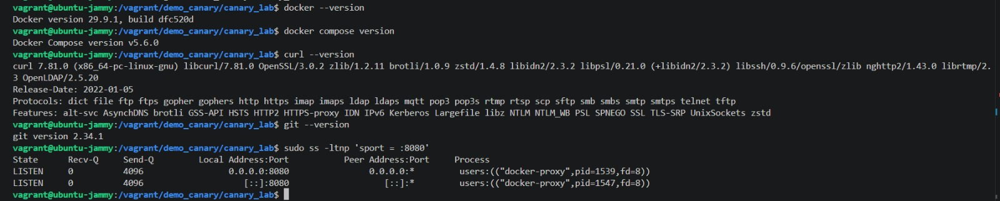

### Iniciar Ubuntu con Vagrant

Desde PowerShell:

```powershell
git clone https://github.com/tuzc0/canary-laboratorio.git
cd canary-laboratorio
vagrant up
vagrant ssh
```

El `Vagrantfile` utiliza la box `ubuntu/jammy64` y la carpeta compartida predeterminada `/vagrant`. No contiene un provisionamiento activo para instalar Docker; una VM nueva necesita esa instalación previa siguiendo la [documentación oficial para Ubuntu](https://docs.docker.com/engine/install/ubuntu/). Los scripts necesitan que el usuario de la sesión pueda ejecutar `docker compose`.

Dentro de Ubuntu:

```bash
cd /vagrant/demo_canary/canary_lab
docker --version
docker compose version
curl --version
git --version
sudo ss -ltnp 'sport = :8080'
```

Si el puerto está ocupado antes de levantar esta práctica, hay que identificar el servicio que lo utiliza. Si corresponde al proxy de este mismo laboratorio, puede revisarse con `docker compose ps`.

### Preparar y arrancar los servicios

```bash
cp -n .env.example .env
chmod +x scripts/*.sh
docker compose up -d --build
docker compose ps
curl -sS http://127.0.0.1:8080/api/info
```

En una reproducción limpia, `.env` utiliza `HOST_PORT=8080` y `GREEN_FAIL=false`. Si ya existe, se deben revisar esos valores sin publicar el archivo. Todos los comandos posteriores se ejecutan desde `/vagrant/demo_canary/canary_lab`.

**Evidencia 2. Servicios y respuesta inicial.** Blue, Green y el proxy están en ejecución; `/api/info` identifica `v1`. Que Green esté iniciado no significa que ya reciba tráfico público.

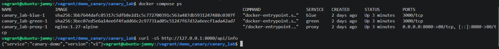

### Acceso desde Windows

Las peticiones de esta práctica se realizaron dentro de la VM, por lo que no requieren acceso HTTP desde Windows. El `Vagrantfile` actual reenvía el puerto `8080` de Windows al `80` de Ubuntu, mientras que Compose publica el laboratorio en el `8080` de Ubuntu: esa regla no apunta al puerto de esta práctica.

Para acceder opcionalmente desde Windows, se puede **reemplazar** la regla existente por la siguiente y aplicar `vagrant reload` desde PowerShell:

```ruby
config.vm.network "forwarded_port", guest: 8080, host: 8080, host_ip: "127.0.0.1"
```

Entonces se consulta `http://127.0.0.1:8080/api/info` en Windows. El puerto del host también debe estar disponible. Este ajuste se documenta como opción; no fue necesario para las capturas tomadas dentro de Ubuntu.

## Etapas de despliegue

`promote.sh` guarda la configuración anterior, copia el contenido de la etapa elegida a `nginx/active.conf`, ejecuta `nginx -t` y solicita la recarga. Si la validación falla, restaura el archivo previo sin solicitar la recarga.

La recarga no equivale a una transición instantánea: antes de medir una etapa, debe permitirse que Nginx aplique la configuración. En la automatización, la promoción y el rollback comprueban varias respuestas consecutivas de la versión esperada. Los resultados siguientes corresponden a las muestras locales aportadas en las capturas.

### Etapa 1. Línea base: Blue 100 %

```bash
./scripts/promote.sh blue
cat nginx/active.conf
docker compose exec -T proxy nginx -t
./scripts/sample.sh 100
```

La configuración incluye únicamente `server blue:3000` en el bloque `upstream backend`. `proxy_pass http://backend` delega el envío al grupo configurado.

**Evidencia 3. Enrutamiento exclusivo a Blue.**

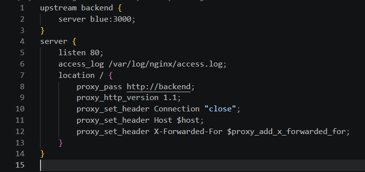

**Evidencia 4. Muestra de línea base:** 100 respuestas `v1` y ninguna `v2`.

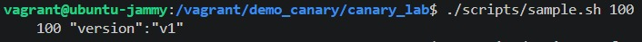

### Etapa 2. Canary al 10 %

```bash
./scripts/promote.sh canary10
cat nginx/active.conf
./scripts/sample.sh 100
```

Los pesos `9` para Blue y `1` para Green expresan una relación aproximada de nueve solicitudes a Blue por una a Green mediante weighted round-robin.

**Evidencia 5. Configuración ponderada 9:1.**

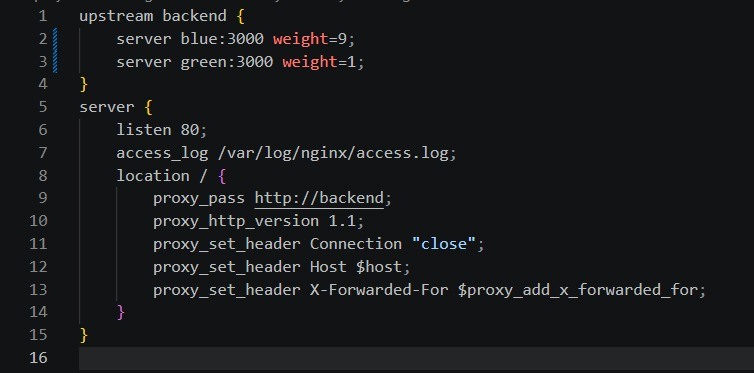

**Evidencia 6. Muestra Canary:** 90 respuestas `v1` y 10 respuestas `v2`.

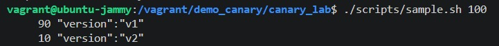

Esta coincidencia con 90/10 no constituye una garantía para cualquier muestra. Los pesos distribuyen solicitudes; no mantienen al 10 % de usuarios identificado de forma persistente. Un usuario podría recibir respuestas de ambas versiones.

### Etapa 3. Promoción al 50 % y después a Green 100 %

```bash
./scripts/promote.sh canary50
cat nginx/active.conf
./scripts/sample.sh 100
```

**Evidencia 7. Pesos iguales:** Blue y Green tienen `weight=1`.

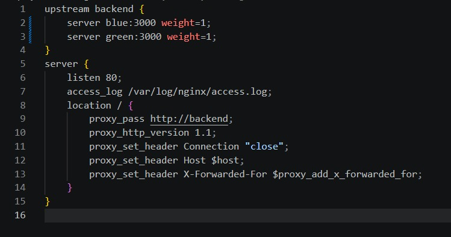

**Evidencia 8. Muestra al 50 %:** 51 respuestas `v1` y 49 respuestas `v2`.

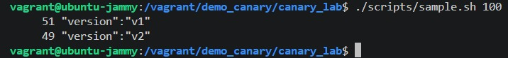

Después se completa la promoción:

```bash
./scripts/promote.sh green
cat nginx/active.conf
./scripts/sample.sh 30
```

**Evidencia 9. Green como único destino del upstream.**

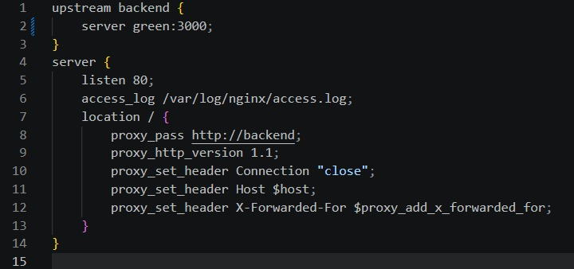

**Evidencia 10. Promoción completa:** 30 respuestas `v2` y ninguna `v1`.

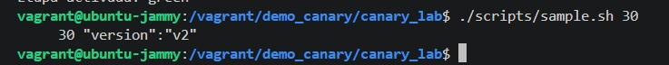

Antes de aumentar del 10 % al 50 %, se revisarían errores de checkout y otros flujos críticos, tasa de respuestas 5xx y latencias p95/p99 por versión. Estas muestras verifican el reparto; por sí solas no prueban rendimiento ni aptitud para producción.

## Incidente y rollback

### Inyección del defecto

Se vuelve a Blue antes de recrear Green con el fallo configurado:

```bash
./scripts/promote.sh blue
GREEN_FAIL=true docker compose up -d --force-recreate green
docker compose ps
./scripts/promote.sh canary10
./scripts/check-checkout.sh 50
```

`GREEN_FAIL=true` hace que Compose entregue `SIMULATE_ERROR=true` a Green. Según [`app/server.js`](demo_canary/canary_lab/app/server.js), su `/api/checkout` responde `503`, mientras `/health` continúa respondiendo `200`.

Para contrastar directamente las dos rutas de Green, puede ejecutarse esta comprobación adicional desde la carpeta del laboratorio:

```bash
docker compose exec -T green node -e '
const http = require("node:http");
for (const path of ["/health", "/api/checkout"]) {
  http.get("http://127.0.0.1:3000" + path, response => {
    console.log(path + " -> HTTP " + response.statusCode);
    response.resume();
  }).on("error", error => {
    console.error(error.message);
    process.exitCode = 1;
  });
}
'
```

Esta comprobación se proporciona para reproducción; no se presenta como una captura realizada. El comportamiento de salud descrito se sustenta en el código y la evidencia aportada muestra los códigos del checkout público.

**Evidencia 11. Fallo funcional:** de 50 solicitudes, 45 devolvieron `200` y 5 devolvieron `503`. La tasa de error observada fue `5 / 50 × 100 = 10 %`.

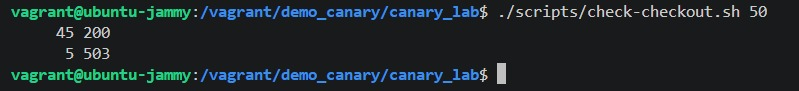

### Decisión y reversión

La nueva versión falla en una operación de negocio. Por ello se detiene la promoción y se retira su tráfico, aunque el health check básico no detecte el defecto.

```bash
./scripts/promote.sh blue
./scripts/check-checkout.sh 20
```

**Evidencia 12. Recuperación:** Nginx valida la configuración de Blue y las 20 solicitudes posteriores devuelven `200`; no aparecen respuestas `503` en esa muestra.

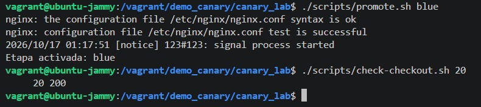

Finalmente se desactiva la simulación, manteniendo Blue como destino estable:

```bash
GREEN_FAIL=false docker compose up -d --force-recreate green
```

Estos comandos revierten el enrutamiento y restauran la configuración de prueba. No revierten cambios en bases de datos ni efectos de negocio; esta API no utiliza persistencia.

## Resultados

### Distribución local observada

| Configuración | Solicitudes | Respuestas v1 | Respuestas v2 | Distribución observada Blue/Green |
|---|---:|---:|---:|---|
| Blue 100 % | 100 | 100 | 0 | 100/0 |
| Canary 10 % | 100 | 90 | 10 | 90/10 |
| Canary 50 % | 100 | 51 | 49 | 51/49 |
| Green 100 % | 30 | 0 | 30 | 0/100 |

### Operación de negocio

| Situación | Solicitudes | HTTP 200 | HTTP 503 | Tasa de error observada |
|---|---:|---:|---:|---:|
| Canary 10 % con Green defectuoso | 50 | 45 | 5 | 10 % |
| Después del rollback a Blue | 20 | 20 | 0 | 0 % |

Los conteos reflejan muestras concretas. Cero errores en 20 solicitudes no demuestra ausencia de defectos en toda condición de uso.

## GitHub Actions

El workflow se encuentra en [`.github/workflows/canary-ci.yml`](.github/workflows/canary-ci.yml), en la raíz del repositorio. `defaults.run.working-directory` sitúa sus comandos en `demo_canary/canary_lab`.

| Elemento | Uso en este workflow |
|---|---|
| `on` | Activa la validación por `push`, `pull_request` o ejecución manual con `workflow_dispatch`. |
| `jobs` | Define el trabajo `test-and-canary`. |
| `runs-on` | Solicita un runner hospedado `ubuntu-latest`. |
| `steps` | Ordena preparación, pruebas, construcción, comprobaciones y limpieza. |
| `uses` | Reutiliza `actions/checkout@v4` y `actions/setup-node@v4`. |
| `run` | Ejecuta comandos Bash, pruebas y operaciones de Compose. |

| Paso | Evidencia que proporciona |
|---|---|
| Checkout repository | Obtiene el código del commit evaluado. |
| Set up Node.js | Prepara Node.js 22 para las pruebas. |
| Prepare laboratory | Crea `.env` desde el ejemplo y da permisos a los scripts. |
| Unit tests | Comprueba salud, identificación de versión y checkout sin fallo simulado. |
| Start two releases and proxy | Construye e inicia la arquitectura con Compose. |
| Wait for HTTP readiness | Espera una respuesta exitosa del endpoint de salud público. |
| Validate canary routing | Toma 100 respuestas y comprueba la presencia de ambas versiones. |
| Promote and rollback | Promueve a Green y regresa a Blue; espera cinco respuestas consecutivas de la versión correspondiente. |
| Logs on failure | Imprime logs si falla un paso previo; se omite cuando no hay fallos. |
| Tear down | Retira los recursos de Compose al finalizar, mediante `if: always()`. |

**Ejecución verificada:** [Canary lab CI #4, exitosa](https://github.com/tuzc0/canary-laboratorio/actions/runs/38992245256), correspondiente al commit [`21fa3de`](https://github.com/tuzc0/canary-laboratorio/commit/21fa3dee2a890b3ff4487ab7e60d841409abd72e).

En esa ejecución se aprobaron las tres pruebas unitarias. La muestra del runner fue de 91 respuestas `v1` y 9 respuestas `v2`; es una ejecución distinta de la muestra local 90/10. Las comprobaciones de promoción, rollback y limpieza finalizaron correctamente.

### Corrección de la espera tras la recarga

Una comprobación inmediata después de `nginx -s reload` podía consultar la configuración anterior. Se agregó `wait_for_version`, con un máximo de 30 intentos y una espera de un segundo entre intentos, para observar cinco respuestas consecutivas de la versión esperada.

Los logs de la ejecución exitosa muestran la transición:

```text
Etapa activada: green
Attempt 1: {"service":"canary-demo","version":"v1"}
Attempt 2: {"service":"canary-demo","version":"v2"}
...
Verified five consecutive responses from v2

Etapa activada: blue
Attempt 1: {"service":"canary-demo","version":"v2"}
Attempt 2: {"service":"canary-demo","version":"v1"}
...
Verified five consecutive responses from v1
```

También se corrigieron la indentación y una tabulación que impedían interpretar el YAML. Los scripts `.sh` se conservan con LF mediante `.gitattributes`. `.env` y `.vagrant/` están excluidos del seguimiento, incluida la llave privada local de Vagrant.

### Alcance y límites

El runner crea un entorno temporal propio; **no despliega en la VM Vagrant local**. Hacer CD hacia esa VM requeriría conectividad, autenticación y controles del ambiente de destino.

La validación Canary actual comprueba que aparecen ambas versiones; no aplica un intervalo estadístico al reparto 90/10. Tampoco automatiza la etapa 50/50, la inyección del fallo ni la medición de latencias. Esas etapas locales se documentan con las capturas. La ventana de cinco respuestas es una comprobación operativa del laboratorio, no una garantía estadística para producción.

Antes de promover no deben omitirse las pruebas, la disponibilidad, la comprobación de versión y la revisión funcional. En un sistema real también se requerirían pruebas de integración y métricas por versión; este workflow no sustituye esos controles.

## Preguntas de la actividad

### 1. ¿Qué diferencia existe entre distribuir el 10 % de solicitudes y liberar a un 10 % fijo de usuarios?

Distribuir solicitudes significa que cada petición se asigna según el balanceo; una misma persona puede recibir ambas versiones. Un grupo fijo de usuarios requiere una identificación persistente y una regla de segmentación, por ejemplo mediante una cookie o un identificador estable. Los pesos 9:1 no implementan esa segmentación por sí solos.

### 2. ¿Por qué una respuesta 200 en `/health` no basta para aprobar una versión?

Porque solo valida lo que esa ruta comprueba. Aquí responde `200` incluso cuando checkout devuelve `503`. Deben probarse los flujos de negocio y observar errores, dependencias y latencias, además de la disponibilidad básica.

### 3. ¿Qué aporta Canary frente a Blue-Green y qué costo adicional introduce?

Permite limitar la exposición inicial y observar el comportamiento antes del cambio completo. A cambio exige operar versiones simultáneas, ajustar el reparto, distinguir métricas por versión y sostener ventanas de evaluación. Blue-Green facilita un cambio directo entre entornos; Canary añade decisiones graduales.

### 4. ¿Qué estrategia aplicarías si la versión nueva modifica de forma irreversible el esquema de datos?

No dependería únicamente de volver el tráfico a v1. Primero buscaría una evolución compatible mediante expand-contract: agregar estructuras, mantener temporalmente compatibilidad, migrar y verificar datos y retirar las estructuras antiguas cuando ya no se requieran. Si la operación realmente debe ser irreversible, se necesita un plan específico de recuperación o corrección hacia adelante, respaldos y restauración probados, y posiblemente una ventana de mantenimiento. Una v1 incompatible con los nuevos datos no es un destino seguro de rollback.

### 5. ¿Por qué GitHub Actions puede validar Compose pero no necesariamente desplegar en tu VM Vagrant?

Porque Compose se ejecuta en el propio runner y utiliza sus recursos. La VM del estudiante está en otra máquina y una red diferente; no existe una ruta de acceso ni autenticación implícita. El éxito del workflow demuestra la validación en el runner, no una actualización del entorno local.

## Reflexión técnica: criterios de promoción

La promoción de una versión debe ser una decisión basada en evidencia de que puede atender las necesidades del usuario. Que el contenedor esté en ejecución, la sintaxis de Nginx sea válida o un endpoint de salud responda correctamente son condiciones necesarias para comenzar a observar, pero no demuestran que la aplicación funcione en sus operaciones principales. En este laboratorio, Green podía seguir indicando salud mientras checkout devolvía errores. Por ello, el criterio central de promoción debe incluir el resultado de los flujos críticos y no limitarse al estado técnico de los procesos.

Antes de introducir tráfico definiría los indicadores y la regla para detener el despliegue. Compararía la tasa de errores de cada versión, la latencia p95 y p99 y la proporción de operaciones completadas. En una compra también revisaría que el resultado sea correcto y que no existan efectos duplicados. Los umbrales deben acordarse según la línea base y los objetivos del servicio; no existe un porcentaje universal que convierta una versión en aceptable. Para esta práctica, observar cinco errores de checkout en cincuenta solicitudes fue suficiente para suspender la promoción porque el defecto estaba configurado en la versión nueva y afectaba directamente la operación evaluada.

El volumen y la duración de la observación también cambian la calidad de la decisión. Una muestra de cien solicitudes ayuda a visualizar el reparto, pero puede dejar fuera rutas poco utilizadas, cargas altas o errores que solo aparecen después de cierto tiempo. Antes de pasar del 10 % al 50 % exigiría una ventana suficiente para representar el uso esperado y comparar ambas versiones bajo condiciones semejantes. Si el tráfico real fuera escaso, completaría la evaluación con pruebas sintéticas e integración, sin interpretar la falta de errores observados como una demostración de ausencia de problemas.

La reversión debe prepararse antes de liberar. Mantendría disponible la versión anterior, definiría quién puede ordenar el rollback y comprobaría que el cambio de enrutamiento realmente se haya aplicado. La corrección del workflow mostró por qué esto importa: solicitar una recarga de Nginx no significa que todas las peticiones posteriores ya utilicen la nueva configuración. Esperar respuestas consecutivas elimina una suposición inmediata de la prueba, aunque no sustituye una observación más extensa. Después de revertir, repetiría los flujos críticos para comprobar la recuperación; las veinte respuestas exitosas de esta actividad son una evidencia limitada de ese paso.

Finalmente, evaluaría la compatibilidad de los datos y los contratos. Mantener dos versiones en paralelo solo es útil si ambas pueden interpretar las solicitudes y trabajar con el estado compartido. Una migración irreversible o un cambio de contrato incompatible puede impedir regresar a Blue aunque el proxy permita hacerlo. Por eso, mi criterio de promoción combinaría funcionamiento del negocio, métricas por versión, observación suficiente y recuperación practicable. Canary reduce la exposición inicial de una falla; su valor depende de que el equipo observe, decida y actúe antes de aumentar esa exposición.

## Conclusión

La práctica permitió observar la transición progresiva entre dos versiones mediante una única entrada HTTP. El proxy simplificó el acceso: el cliente utilizó el mismo puerto y la misma ruta mientras Nginx seleccionaba Blue o Green según la etapa. La distribución local siguió las proporciones esperadas y el incidente mostró la necesidad de evaluar una operación de negocio además de la salud básica. Al detectar errores se retiró el tráfico de Green y las veinte solicitudes posteriores a Blue fueron exitosas. GitHub Actions complementó la evidencia local con pruebas y validación reproducible del enrutamiento en un entorno temporal.

## Limpieza y diagnóstico

Desde la carpeta del laboratorio:

```bash
docker compose ps
docker compose exec -T proxy nginx -t
docker compose logs --tail=50 proxy
docker compose down
```

Después de salir de Ubuntu con `exit`, se puede detener la VM desde PowerShell con `vagrant halt`. La detención de la VM y el rollback del tráfico son operaciones distintas.

## Referencias

- [Guía del laboratorio incluida con el proyecto](demo_canary/canary_lab/docs/manual.pdf).
- [Repositorio base: sdominguez/deployment-strategies](https://github.com/sdominguez/deployment-strategies).
- [NGINX: HTTP Load Balancing](https://docs.nginx.com/nginx/admin-guide/load-balancer/http-load-balancer/).
- [NGINX: Controlling nginx y recarga de configuración](https://nginx.org/en/docs/control.html).
- [Docker: Compose](https://docs.docker.com/compose/).
- [Docker: instalación de Engine en Ubuntu](https://docs.docker.com/engine/install/ubuntu/).
- [GitHub: Understanding GitHub Actions](https://docs.github.com/en/actions/get-started/understand-github-actions).
- [GitHub: directorio de trabajo y shell predeterminados](https://docs.github.com/en/actions/how-tos/write-workflows/choose-what-workflows-do/set-default-values-for-jobs).
- [HashiCorp: puertos reenviados de Vagrant](https://developer.hashicorp.com/vagrant/docs/networking/forwarded_ports).
- [Google SRE: Release Engineering](https://sre.google/sre-book/release-engineering/).
